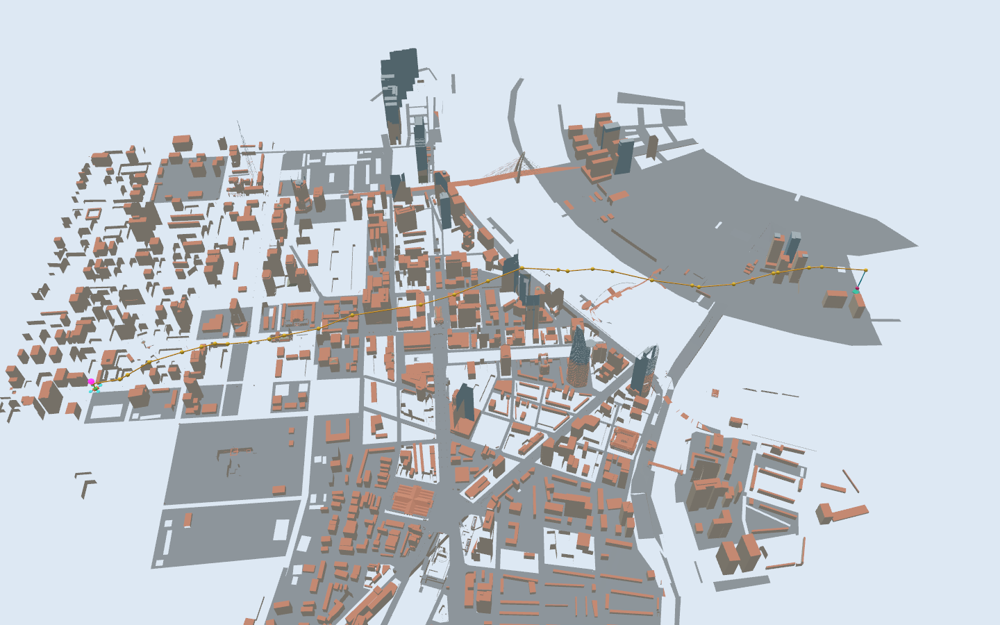

# UAV giao hàng trên bề mặt 3D bằng Funnel Tree

Trong dự án này, nhóm triển khai thuật toán Funnel Tree bằng Python để lập
tuyến trên bề mặt đa diện và mô phỏng một UAV bám tuyến trong Gazebo Harmonic.
Quy trình đọc mô hình thành phố `city.glb`,
dựng bề mặt dẫn đường 3D phía trên địa hình và công trình, chạy Funnel Tree,
đối chiếu độ dài với bộ giải MMP độc lập, rồi mô phỏng tiếp cận điểm giao hàng.



## Kết quả hiện tại

| Thành phần | Kết quả đã kiểm tra |
| --- | --- |
| Mô hình thành phố | 301.490 tam giác, đổi trục và chuẩn hóa kích thước ngang về 200 đơn vị |
| Bề mặt dẫn đường 3D | Phủ toàn thành phố: 2.295 đỉnh, 4.400 tam giác, ô danh nghĩa 5 đơn vị |
| Khoảng hở dựng bề mặt | Đứng tối thiểu 1,5 đơn vị, dự phòng ngang 1,6 |
| Độ dài chặng trên bề mặt bằng Funnel | 142,418721777849 đơn vị mô phỏng |
| Độ dài MMP tham chiếu | 142,418721777849 đơn vị mô phỏng |
| Sai lệch bám tuyến lớn nhất trong lượt đã lưu | Khoảng 0,002363 đơn vị mô phỏng |
| Cao độ chặng bám bề mặt trong lượt đã lưu | Khoảng 7,68–16,57 đơn vị mô phỏng |
| Giới hạn tốc độ / tốc độ hạ giao hàng | 5 / 1 đơn vị mô phỏng mỗi giây |
| Thời gian hoàn tất kế hoạch | Khoảng 100,7 giây mô phỏng |

Đối chiếu MMP dùng cùng lưới và cùng hai đầu mút của chặng trên bề mặt.
Hai đường đều được kiểm tra thuộc bề mặt. Đây là kiểm chứng số cho ca đã lưu.
Các đoạn tiếp cận bề mặt và hạ tại điểm giao được kiểm tra riêng bằng telemetry.

Lưới phủ toàn thành phố đã được đối chiếu MMP. Bộ kết quả bay đã lưu được
đo trong Gazebo không giao diện, cùng bước vật lý 0,002 giây. Cấu hình hiện
tại bỏ thời gian chờ tại waypoint, tăng giới hạn tốc độ từ 3 lên 5, giữ
giới hạn gia tốc 3 và tốc độ hạ giao hàng 1. Thời gian kế hoạch giảm từ
158,3 xuống 100,7 giây mô phỏng. Drone vẫn giảm tốc về 0 ở các góc của
đường gấp khúc; chưa bo góc hay bay xuyên waypoint với vận tốc khác 0.
Log tiến độ mỗi 10 giây chỉ phục vụ theo dõi, độc lập với chuyển động.

- [Kết quả đối chiếu MMP](generated/funnel_surface_reference/comparison.md)
- [Số liệu kiểm tra bám bề mặt](generated/funnel_physics/surface_delivery/surface_validation.json)
- [Biểu đồ cao độ](generated/funnel_physics/surface_delivery/surface_altitude_profile.png)
- [Ảnh gần điểm giao](generated/funnel_physics/surface_delivery/city_destination.png)

## Thí nghiệm một START đến ba đích

Ba ca `g1`, `g2`, `g3` sử dụng cùng điểm xuất phát và cùng lưới phủ toàn
thành phố. G1 giữ nhà đích hiện tại; G2 và G3 là hai vị trí giao hàng khác,
cách các đích đã chọn ít nhất 45 đơn vị, có nền đỡ, cột hạ trống và mặt nhà
gần đó. Đây là ba truy vấn độc lập, không phải một hành trình ghé ba nhà.

Trong **VS Code — Terminal 1**, chọn một ca để xem Gazebo; đóng phiên cũ
trước khi đổi ca:

```powershell
wsl.exe -d Ubuntu-24.04 --cd /mnt/c/DroneDemo/drone_gazebo_demo -- bash scripts/run_surface_gpu.sh --destination=g1 --show-surface
```

Thay `g1` bằng `g2` hoặc `g3`. Để dùng CPU, thay `run_surface_gpu.sh` bằng
`run_surface_cpu.sh`. Các lệnh mặc định không có `--destination` vẫn chạy
demo giao hàng ban đầu.

Sau lượt bay, trong **VS Code — Terminal 2**, phân tích ca vừa chạy và cập
nhật bảng tổng hợp:

```powershell
wsl.exe -d Ubuntu-24.04 --cd /mnt/c/DroneDemo/drone_gazebo_demo -- .venv/bin/python tools/run_city_three_goals.py --stage analyze --destination g1
```

Tính lại toàn bộ ba tuyến, đối chiếu MMP và mô phỏng không giao diện:

```powershell
wsl.exe -d Ubuntu-24.04 --cd /mnt/c/DroneDemo/drone_gazebo_demo -- .venv/bin/python tools/run_city_three_goals.py --stage all
```

- [Bảng tổng hợp](generated/city_three_goals/summary.md)
- [Số liệu ba ca](generated/city_three_goals/results.json)
- [Hình ba tuyến](generated/city_three_goals/routes.png)

Kết quả từng ca nằm trong `generated/city_three_goals/g1`, `g2`, `g3`.
Thời gian lập tuyến được ghi rõ số nguồn tính mới và số nguồn dùng lại
cache; không diễn giải các lượt nối tiếp này là phép so sánh cold-start.

## Môi trường

### Các thư viện chính

| Thư viện / runtime | Vai trò trong mã nguồn |
| --- | --- |
| NumPy | Mảng tọa độ, tính toán hình học và phép toán tuyến tính trong Funnel Tree, đọc GLB và xử lý telemetry |
| Shapely | Truy vấn không gian, kiểm tra footprint và cột hạ, dựng bề mặt dẫn đường |
| Matplotlib | Biểu đồ tuyến, cao độ và kết quả thực nghiệm |
| Gazebo Harmonic: `gz.sim8`, `gz.math7` | Mô phỏng vật lý, đọc trạng thái và tác dụng lực lên UAV |
| pygeodesic | Bộ giải MMP độc lập để đối chiếu; không thay thế Funnel Tree khi lập tuyến |
| Thư viện chuẩn Python | `math`, `json`, `csv`, `pathlib`, `hashlib`, `heapq`, `argparse`, `xml.etree.ElementTree` và các tiện ích hệ thống |
| trimesh | Công cụ khảo sát cũ trong `tools/dev/`, không bắt buộc cho lệnh chạy demo hiện tại |

Toàn bộ mã Python của nhóm ở thư mục gốc, `src/`, `tools/`, `tests/` và các
script trong `scripts/` có thông báo BSD-3-Clause cùng thư viện hoặc runtime
chính ở phần đầu. Module nội bộ được ghi riêng với thư viện bên ngoài.
`requirements-demo.txt` và `requirements-reference.txt` lưu các
phiên bản đã dùng; một thư viện có trong bộ cài không đồng nghĩa mọi module
đều sử dụng nó. Gazebo dùng Python bindings cài qua hệ thống Ubuntu.

[Biên bản rà soát header](generated/source_header_audit.json) ghi nhận các
file đã kiểm tra. Việc bổ sung chú thích giữ nguyên cấu trúc thực thi Python;
các dấu vân tay phụ thuộc mã nguồn được cập nhật, không tính lại số liệu bay.

- Ubuntu 24.04, hoặc Ubuntu 24.04 trên WSL2 với WSLg để mở giao diện.
- Gazebo Harmonic / Gazebo Sim 8 và Python bindings của hệ thống.
- Python 3.12. Các phiên bản thư viện đã dùng nằm trong `requirements-demo.txt`.

Quy ước hai terminal trong hướng dẫn này:

- **Ubuntu 1** mở Gazebo. Dùng `Ctrl+C` để kết thúc phiên.
- **Ubuntu 2** cài thư viện, lập tuyến, kiểm tra và xuất kết quả.

Mỗi terminal cần ở thư mục gốc của repository. Ví dụ trên máy đang phát triển:

```bash
cd /mnt/c/DroneDemo/drone_gazebo_demo
```

Nếu clone sang vị trí khác, dùng đường dẫn thư mục clone tương ứng.

## Cài đặt một lần

Trong **Ubuntu 2**, tại thư mục gốc repository:

```bash
bash scripts/install_ubuntu.sh
python3 -m venv .venv
.venv/bin/python -m pip install -r requirements-demo.txt
```

Script cài Gazebo cần `sudo` và kết nối mạng. Script này dành cho Ubuntu 24.04.
Các lệnh dưới đây gọi trực tiếp Python trong môi trường ảo, nên có thể dùng
ngay từ terminal mới.

Để chạy phép đối chiếu MMP, cài thêm bộ giải tham chiếu trong **Ubuntu 2**:

```bash
.venv/bin/python -m pip install --no-deps \
  --target generated/funnel_surface_reference/runtime \
  -r requirements-reference.txt
```

Plugin điều khiển trong Gazebo dùng Python hệ thống và các gói `gz` được cài
bằng apt. `scripts/gazebo_system_python.sh` thiết lập môi trường cho tiến trình đó.

## Chạy mô phỏng hiện tại

Đóng phiên Gazebo cũ. Trong **Ubuntu 1**:

```bash
bash scripts/run_funnel_physics.sh surface_delivery
```

Drone bắt đầu tại START đã lưu, tiếp cận bề mặt dẫn đường, lên xuống theo
tuyến Funnel màu cam, rồi hạ thẳng đứng và giữ vị trí trên bục giao màu xanh.
Lượt hiện tại kéo dài khoảng 2 phút 38 giây mô phỏng. Dấu hồng phía trên
drone giúp quan sát khi nhìn toàn thành phố.

Muốn hiện thêm bề mặt dẫn đường trong suốt, chạy trong **Ubuntu 1**:

```bash
bash scripts/run_funnel_physics.sh surface_delivery --show-surface
```

### Hai lệnh chạy riêng cho CPU và GPU

Trong **Ubuntu 1**, chọn một lệnh sau, mỗi lần mở một phiên Gazebo.

GPU qua D3D12 trên WSLg, theo cấu hình đã chạy mượt trên máy phát triển:

```bash
bash scripts/run_surface_gpu.sh
```

CPU qua Mesa llvmpipe, dùng khi cần chạy bằng phần mềm:

```bash
bash scripts/run_surface_cpu.sh
```

Cả hai mặc định chạy `surface_delivery`. Có thể thêm `--show-surface` vào
cuối lệnh. Script GPU xóa thiết lập ép render CPU được kế thừa từ terminal,
còn script CPU đặt rõ `LIBGL_ALWAYS_SOFTWARE=1` và `GALLIUM_DRIVER=llvmpipe`.
Chế độ GPU yêu cầu WSLg và driver hỗ trợ D3D12 trên máy chạy.

Lệnh gốc `run_funnel_physics.sh` dùng driver mặc định của hệ thống. Tùy chọn
`--software` của lệnh gốc bật render CPU. Hai script mới chọn rõ backend đồ
họa cho cùng pipeline lập tuyến và mô phỏng vật lý.

Nhóm sử dụng hai script trong `scripts/` để quản lý cấu hình render. Ca mô
phỏng được chọn bằng biến môi trường. Ví dụ trong **Ubuntu 1**:

```bash
FUNNEL_DEMO_CASE=original bash scripts/run_surface_cpu.sh
```

Repository giữ một bộ dữ liệu đã lập tuyến để chạy ca hiện tại ngay sau cài
đặt. Script luôn tạo lại SDF và đường dẫn tài nguyên theo vị trí clone.
Các tệp SDF chạy thử, log và cache tính toán lớn được tạo cục bộ.

## Kiểm tra sau lượt chạy

Đóng Gazebo, rồi trong **Ubuntu 2**:

```bash
.venv/bin/python tools/analyze_surface_delivery.py
.venv/bin/python tools/compare_surface_geodesic.py
```

Kết quả mong đợi lần lượt là `checks_passed: true` và
`MATCHES_EXACT_REFERENCE`. Dữ liệu lưu tại:

```text
generated/funnel_physics/surface_delivery/surface_validation.json
generated/funnel_physics/surface_delivery/surface_altitude_profile.png
generated/funnel_surface_reference/comparison.json
generated/funnel_surface_reference/comparison.md
```

Trong **Ubuntu 2**, có thể kiểm tra bộ bốn ca phẳng đã lưu:

```bash
.venv/bin/python tools/verify_project_results.py
```

## Lập lại tuyến khi thay đổi bản đồ hoặc thuật toán

Trong **Ubuntu 2**, khi Gazebo đã đóng:

```bash
.venv/bin/python tools/plan_surface_delivery.py --cell 5 --coverage city
.venv/bin/python tools/compare_surface_geodesic.py
```

Sau đó chạy lại mô phỏng trong **Ubuntu 1** và xuất telemetry mới. Bộ lập
tuyến lưu checkpoint cho các nguồn Funnel. Thời gian tính phụ thuộc kích
thước lưới và số nguồn phụ.

`--coverage city` dựng lưới phủ toàn bộ giới hạn ngang của thành phố, thêm
vùng đệm 16 đơn vị và làm tròn theo kích thước ô. Đây là chế độ mặc định.
`--coverage mission` giới hạn lưới quanh START/GOAL như các lượt thử trước.
Đổi phạm vi lưới cần chạy lại phép đối chiếu MMP và mô phỏng trước khi dùng
kết quả telemetry để đánh giá bản mới.

Kế hoạch lưu SHA256 của đầu vào và mã liên quan. Nếu sửa một tệp đầu vào,
cần lập lại kế hoạch tương ứng. Khi thay đổi cả pipeline miền phẳng, xem
[hướng dẫn chi tiết](RUNBOOK_CURRENT.md) và các công cụ trong `tools/`.

## Cấu trúc thư mục

| Đường dẫn | Nội dung |
| --- | --- |
| `src/funnel_tree.py` | Lan truyền Funnel, cắt tỉa và tái dựng đường |
| `src/mesh.py` | Lưới tam giác và quan hệ kề |
| `src/trajectory.py` | Tham số hóa thời gian và luật phản hồi |
| `src/funnel_drone_system.py` | Plugin bám tuyến trong Gazebo |
| `tools/plan_surface_delivery.py` | Dựng bề mặt 3D và tính tuyến Funnel |
| `tools/prepare_funnel_physics.py` | Tạo world, route, bục giao và cấu hình giao diện |
| `tools/prepare_city_visual.py` | Phân màu hình học thành phố |
| `tools/compare_surface_geodesic.py` | Đối chiếu với MMP qua pygeodesic |
| `tools/analyze_surface_delivery.py` | Kiểm tra telemetry trên lưới 3D |
| `tests/` | Kiểm thử cắt tỉa, phạm vi đích và gọi dịch vụ pose |
| `tools/dev/` | Công cụ khảo sát và bảo trì của các giai đoạn trước |
| `scripts/` | Cài đặt và mở mô phỏng |
| `assets/city.glb` | Mô hình thành phố kèm nguồn và giấy phép |
| `data/input`, `data/expected` | Năm mesh mẫu và dữ liệu đối chiếu |
| `generated/` | Bộ dữ liệu đã kiểm tra và các kết quả sinh ra |

`RUNBOOK_CURRENT.md` là hướng dẫn vận hành chi tiết.
Các hướng dẫn khảo sát và phương án trước được lưu trong
[tài liệu thử nghiệm](docs/experiments/README.md).
Mục lục [dữ liệu và kết quả](generated/README.md) phân biệt bộ demo hiện tại,
các thí nghiệm đã lưu và dữ liệu chạy tạm.

## Phạm vi kết quả

- Mô hình bay hiện là một khối điểm 1 kg điều khiển bằng lực, bù trọng lực,
  feedforward và PD. Rotor là hình minh họa. Điều khiển tư thế, autopilot,
  phần cứng thực và nhiều UAV còn là phần phát triển tiếp theo.
- Lưới bay là bề mặt an toàn dựng phía trên thành phố. Tối ưu được xét trên
  bề mặt đó. Các ô lấy chiều cao lớn nhất và tạo dốc nên khoảng hở có thể
  lớn hơn giá trị tối thiểu.
- Bản đồ được chuẩn hóa về đơn vị mô phỏng. Các kích thước chưa được đối
  chiếu với đo đạc địa lý thực tế. Màu công trình được phân theo hình học.
- Bản cài đặt Funnel còn thực nghiệm. Phần tái dựng trải phẳng dải mặt đã
  chọn. Đối chiếu thành công cho ca hiện tại chưa chứng minh bản cài đặt
  đúng trên mọi lưới.

## Giấy phép

Phần mã nguồn do nhóm đóng góp được phát hành theo **BSD-3-Clause**, xem
[LICENSE](LICENSE). Thông báo bản quyền dùng tên chung
`uav-funnel-tree-gazebo contributors` cho các tác giả đóng góp mã nguồn.

Giấy phép này không thay thế giấy phép của thư viện, mã bên thứ ba hay dữ
liệu được sử dụng trong dự án. Mô hình thành phố và các bản chuyển đổi của
nó giữ giấy phép **CC BY 4.0**, với thông tin nguồn trong
[ATTRIBUTION.md](ATTRIBUTION.md). Giấy phép bản thảo bài báo được quyết định riêng.

## Tài liệu tham khảo

Thuật toán dựa trên bài báo của Phan Thanh An, Tran Van Hoai và Vuong Ba Thinh,
*The funnel tree algorithm for finding shortest paths on polyhedral surfaces*,
DOI [10.1080/02331934.2023.2241496](https://doi.org/10.1080/02331934.2023.2241496).
Bộ giải MMP độc lập dùng [pygeodesic](https://github.com/mhogg/pygeodesic).

Mô hình thành phố của **Saigon 3D City**, giấy phép **CC BY 4.0**. Nguồn asset,
các biến đổi và thông tin thuật toán nằm trong [ATTRIBUTION.md](ATTRIBUTION.md).
